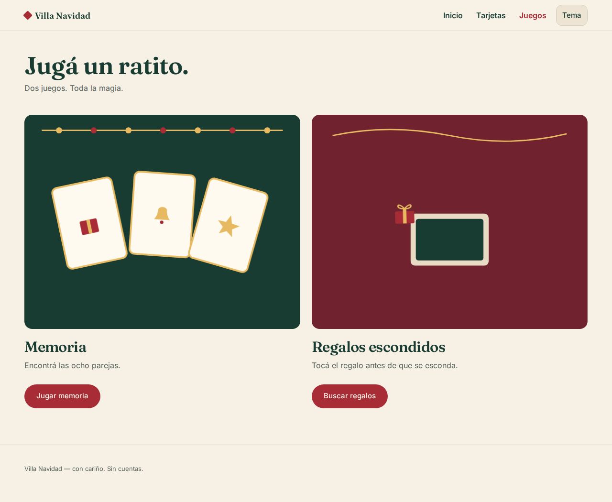
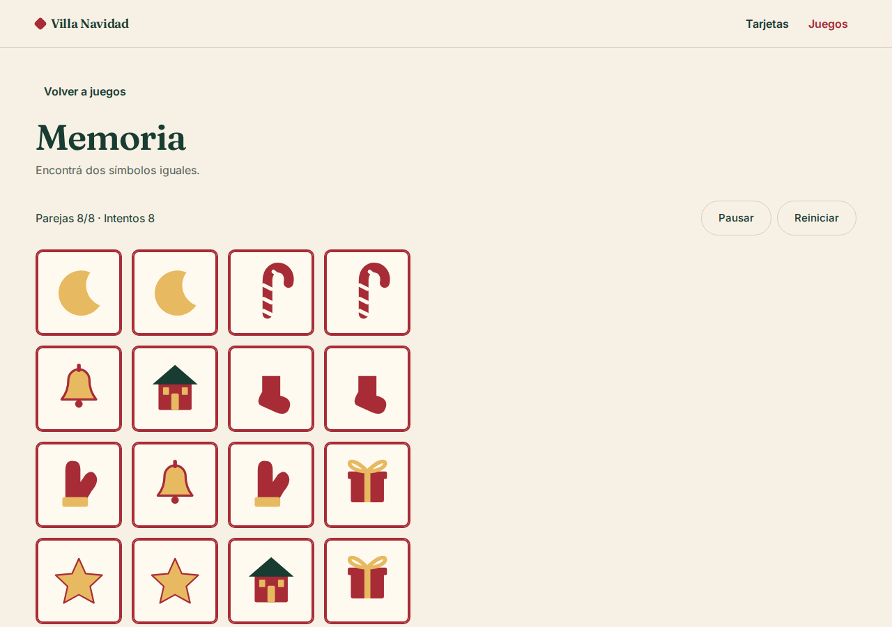
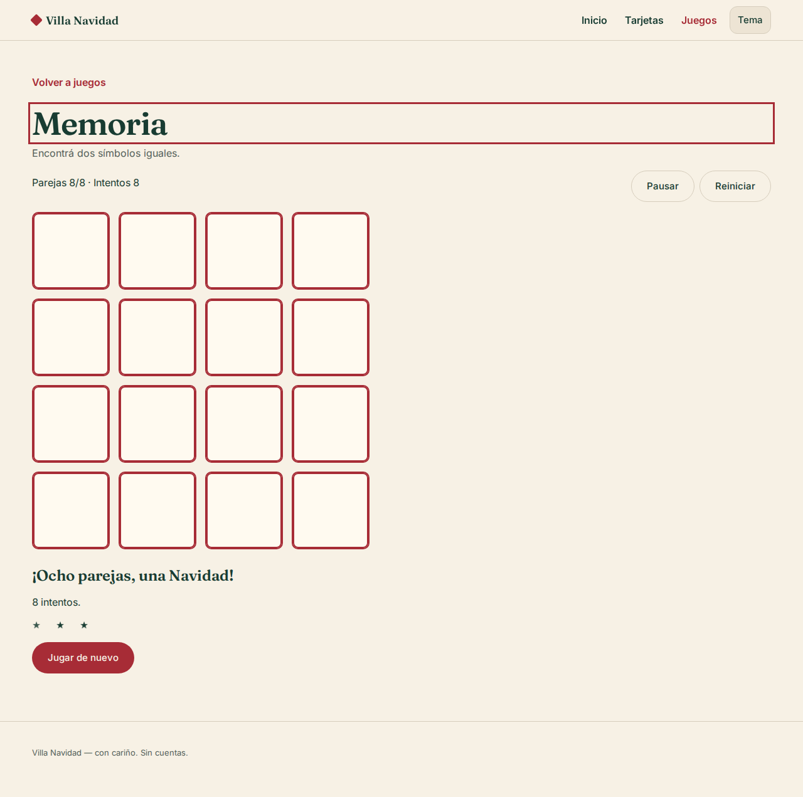
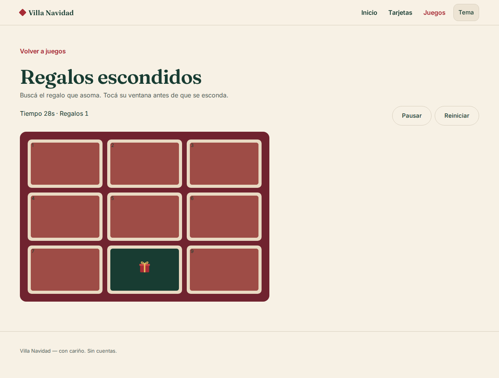
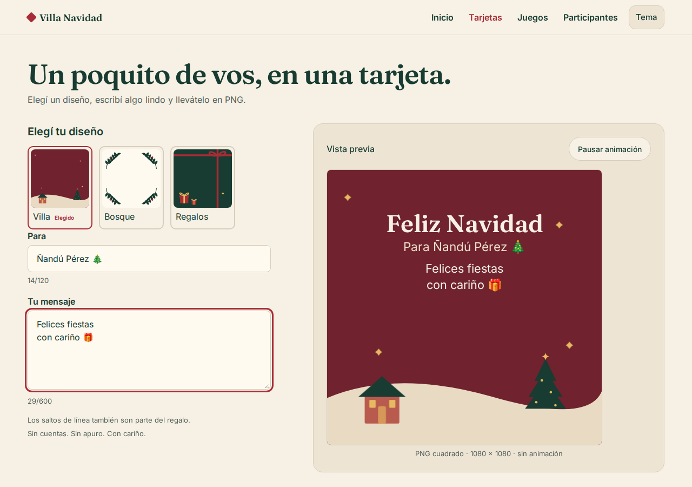

# Paridad React → vanilla

Referencia React (primer padre del merge vanilla `71eab17`):

**`2ad0b3493751b91c9fd6e464da2d98a429085814`**

## Tabla React ↔ vanilla

| Pantalla / estado | React | Vanilla |
| --- | --- | --- |
| Landing |  |  |
| Selector de juegos |  |  |
| Memoria mid-play |  |  |
| Memoria fin |  |  |
| Regalos mid-play |  |  |
| Regalos fin |  |  |
| Tarjetas + preview |  |  |
| PNG descargado |  |  |

## Mapa función React → equivalente vanilla

| React | Vanilla |
| --- | --- |
| `pages/Landing.tsx` | `index.html` + `js/main.js` (countdown) |
| `pages/Tarjetas.tsx` + `CardEditor.tsx` + `CardPreview.tsx` | `tarjetas.html` + `js/form.js` + `js/card-preview.js` + `js/vendor/html-to-image.js` |
| `pages/Juegos.tsx` (selector) | `juegos.html` `#view-catalog` |
| `pages/MemoriaPage.tsx` + `MemoryGame.tsx` | `juegos.html#memoria` + `js/juegos.js` / `js/game-logic.js` |
| `pages/RegalosPage.tsx` + `HiddenGiftsGame.tsx` | `juegos.html#regalos` + `js/juegos.js` / `js/game-logic.js` |
| `utils/cardFit.ts` | `js/card-preview.js` (`cardTextOverflows`) |
| `utils/shuffle.ts` + siluetas | `js/game-logic.js` + iconos en `js/juegos.js` |

## Colocación rúbrica (regla PO — solo secciones React existentes)

| Ítem | Dónde | Archivo:línea |
| --- | --- | --- |
| Video corto | Hero de landing (sección React existente) | `index.html:60` (`.hero-video`), source `index.html:67` |
| Audio play/mute | Header del catálogo de juegos | `juegos.html:54` (`#audio-toggle`), `juegos.html:57–58` (`#game-audio`), JS `js/juegos.js:15` |
| Imágenes como vínculos | Miniaturas de plantilla | `tarjetas.html:57–86` (`<a class="template-pick" href="#vista-previa">` + ``), ancla `tarjetas.html:121` |
| Enlace externo | Footer existente | `index.html:213`, `tarjetas.html:155`, `juegos.html:191` |
| Placeholder | Campos del editor React | `tarjetas.html:98` (`#dest`), `tarjetas.html:111` (`#msg`) |

Sin galería, sin página nueva, sin sección nueva, sin función nueva de producto.

## Nota de arquitectura
React tenía `/juegos/memoria` y `/juegos/regalos`; en vanilla se emulan con hash en `juegos.html` (siguen siendo exactamente 3 páginas HTML).
