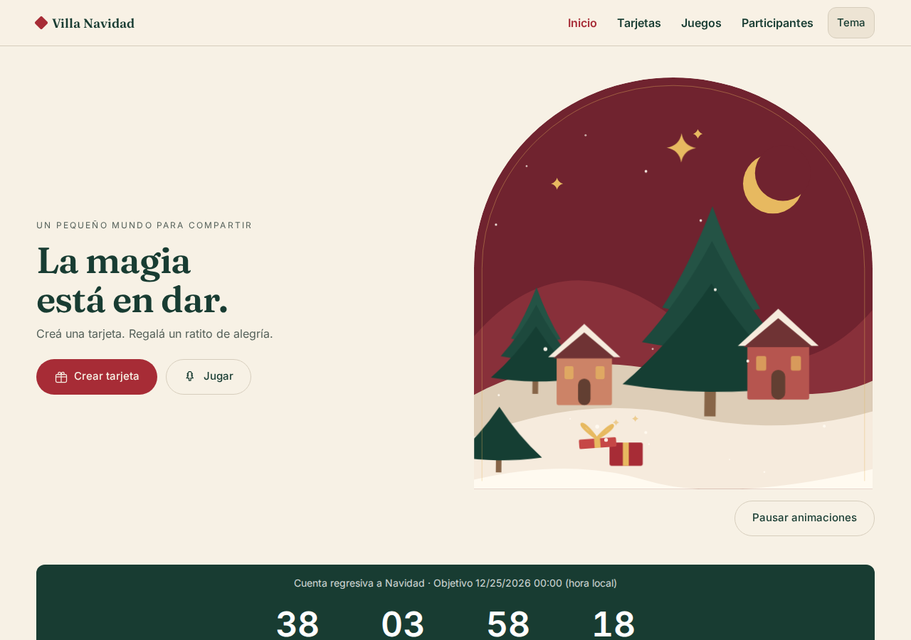
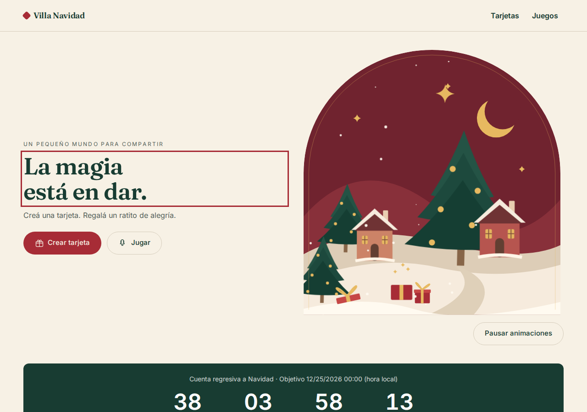
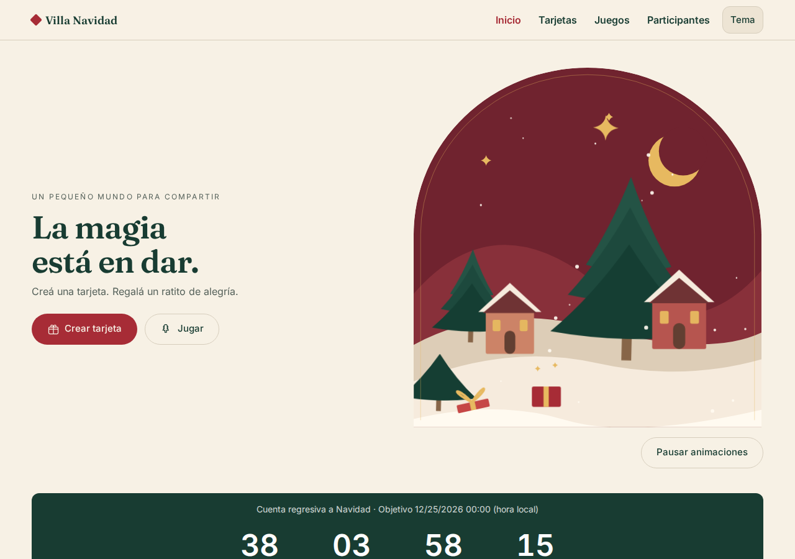
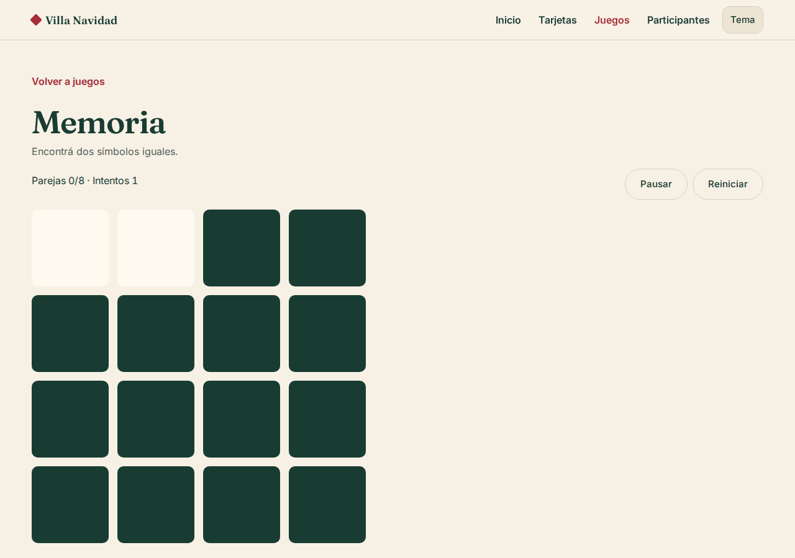
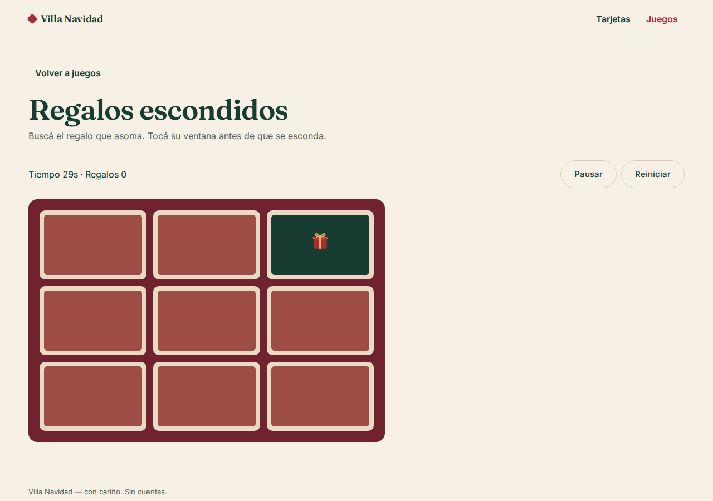
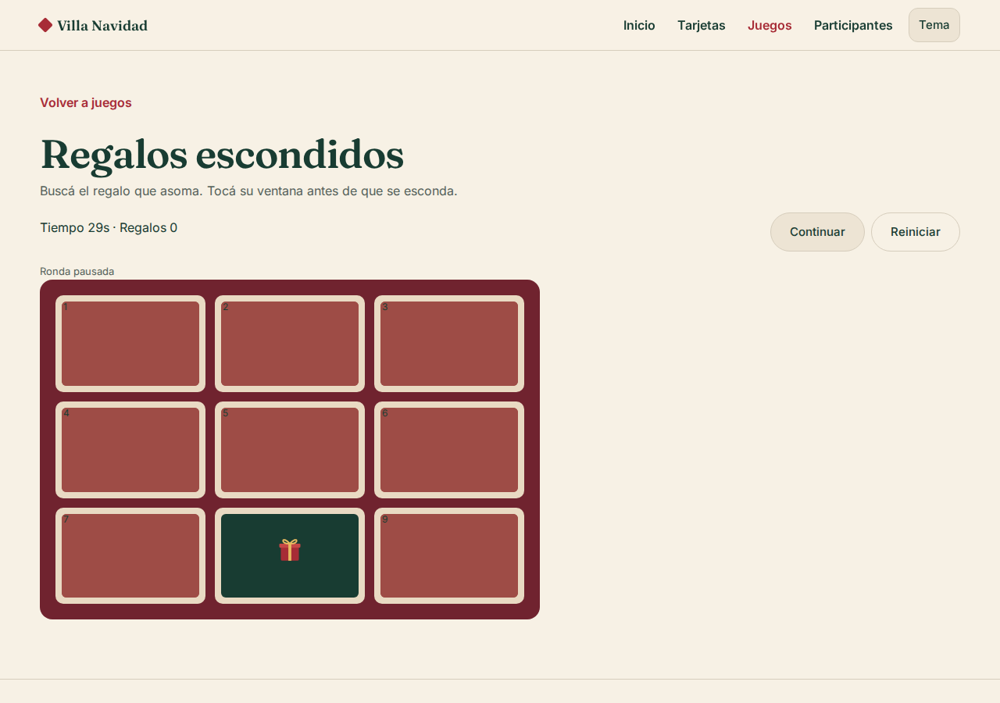

# Paridad React → vanilla + página Participantes

Referencia React (primer padre del merge vanilla `71eab17`):

**`2ad0b3493751b91c9fd6e464da2d98a429085814`**

## Regla vigente (owner / PO)

1. Las 3 pantallas React (inicio, tarjetas, juegos) quedan en **paridad** de funciones y diseño.
2. Multimedia y rúbrica que romperían esa paridad viven en **`participantes.html`**.
3. Nav: solo se suma el enlace a Participantes. Footer: enlace externo.
4. Countdown el 25/12: vanilla mantiene «¡Feliz Navidad!» (pendiente PO; no forzar salto a 2027).

## Tabla React ↔ vanilla

| Pantalla / estado | React | Vanilla |
| --- | --- | --- |
| Landing |  |  |
| Landing + nieve |  |  |
| Selector de juegos |  |  |
| Memoria mid-play |  |  |
| Memoria fin |  |  |
| Regalos mid-play |  |  |
| Regalos pausado |  |  |
| Regalos fin |  |  |
| Tarjetas + preview |  |  |
| PNG descargado |  |  |

## Mapa función React → equivalente vanilla

| React | Vanilla |
| --- | --- |
| `Landing.tsx` + `SnowfallBox` + `PauseButton` | `index.html` + `js/snowfall.js` + `js/motion.js` |
| `Tarjetas` / `CardEditor` / `CardPreview` | `tarjetas.html` + form/preview + html-to-image |
| `Juegos.tsx` + `PauseButton` + `CatalogRegalosArt` | `juegos.html` `#view-catalog` (grilla 3×3) |
| `MemoriaPage` / `MemoryGame` | `juegos.html#memoria` |
| `RegalosPage` / `HiddenGiftsGame` | `juegos.html#regalos` |
| *(rúbrica multimedia / créditos)* | `participantes.html` |

## Checklist → archivo:línea

| Ítem | Ubicación |
| --- | --- |
| Deploy Pages incluye Participantes | `.github/workflows/deploy-pages.yml:30` |
| Nieve + Pausar animaciones (landing) | `index.html` `#snowfall-host` / `[data-motion-pause]` · `js/snowfall.js` · `js/motion.js` |
| Catálogo regalos 3×3 | `juegos.html` `#catalog-regalos` (9 `<g>`) |
| PauseButton catálogo | `juegos.html` `[data-motion-pause]` en `#view-catalog` |
| PauseButton regalos (partida) | `juegos.html` `#gifts-pause` · `js/juegos.js` |
| Iconos CTA landing | `index.html` `.cta-icon` en `.hero-ctas` |
| `#download-png:disabled` | `css/custom.css` `.btn-cta:disabled` |
| Fecha countdown (locale default) | `js/main.js` `toLocaleDateString()` |
| Video / audio / img-vínculo / créditos | `participantes.html` |
