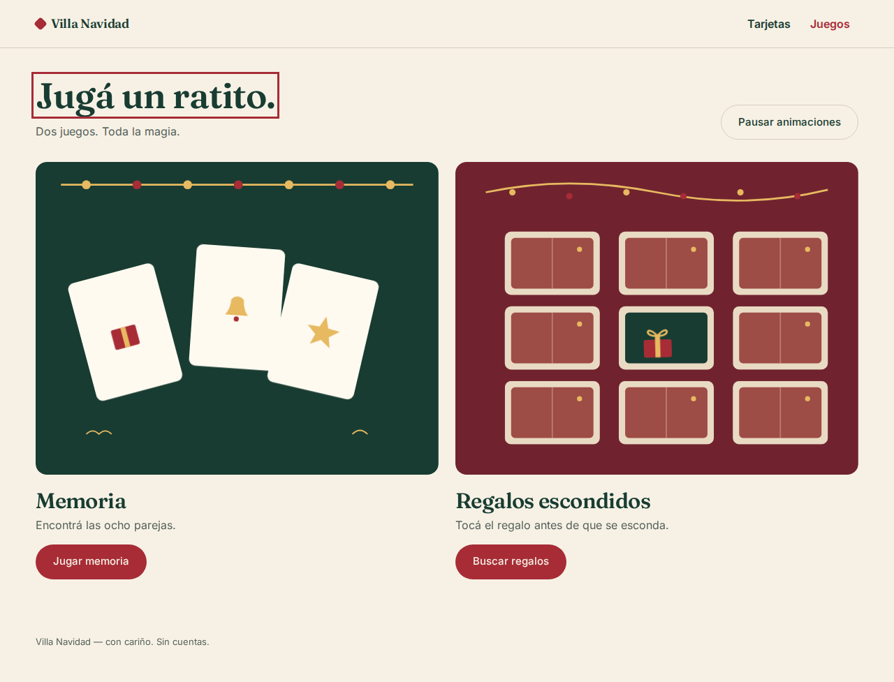
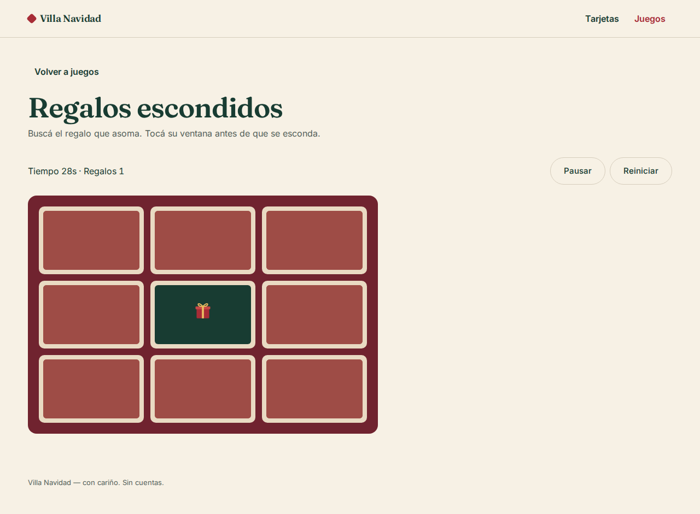

# Paridad React → vanilla

Referencia React (primer padre del merge vanilla `71eab17`):

**`2ad0b3493751b91c9fd6e464da2d98a429085814`**

## Tabla React ↔ vanilla

| Pantalla / estado | React | Vanilla |
| --- | --- | --- |
| Landing |  |  |
| Selector de juegos |  |  |
| Memoria mid-play |  |  |
| Memoria fin |  |  |
| Regalos mid-play |  |  |
| Regalos fin |  |  |
| Tarjetas + preview |  |  |
| PNG descargado |  |  |

## Mapa función React → equivalente vanilla

| React | Vanilla |
| --- | --- |
| `pages/Landing.tsx` | `index.html` + `js/main.js` (countdown) |
| `pages/Tarjetas.tsx` + `CardEditor.tsx` + `CardPreview.tsx` | `tarjetas.html` + `js/form.js` + `js/card-preview.js` + `js/vendor/html-to-image.js` |
| `pages/Juegos.tsx` (selector) | `juegos.html` `#view-catalog` |
| `pages/MemoriaPage.tsx` + `MemoryGame.tsx` | `juegos.html#memoria` + `js/juegos.js` / `js/game-logic.js` |
| `pages/RegalosPage.tsx` + `HiddenGiftsGame.tsx` | `juegos.html#regalos` + `js/juegos.js` / `js/game-logic.js` |
| `utils/cardFit.ts` | `js/card-preview.js` (`cardTextOverflows`) |
| `utils/shuffle.ts` + siluetas | `js/game-logic.js` + iconos en `js/juegos.js` |

## Conflictos rúbrica vs paridad exacta (STOP)

Integrar estos ítems de rúbrica **cambiaría** pantallas/flujos que en React no existían; por instrucción del PO se detuvo y no se inventó:

1. **checkbox** — `CardEditor` React no tenía casillas; agregarlas altera el taller.
2. **video / audio** — Landing y Juegos React no tenían multimedia; agregarlos altera esas pantallas.
3. **Escalera h3–h6 / secciones didácticas / galería** — no estaban en React Scout V2.
4. **Imágenes como vínculos Unsplash** — React usaba miniaturas SVG de plantilla en botones, no galería.
5. **3 archivos HTML vs rutas SPA** — React tenía `/juegos/memoria` y `/juegos/regalos`; en vanilla se emulan con hash en `juegos.html` (sigue habiendo exactamente 3 páginas).

**Sí en paridad React:** placeholders en `#dest` / `#msg`.
