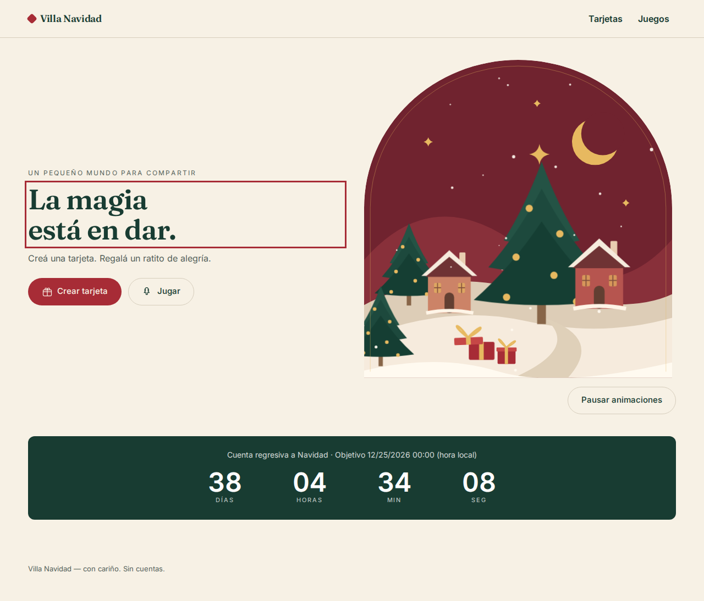
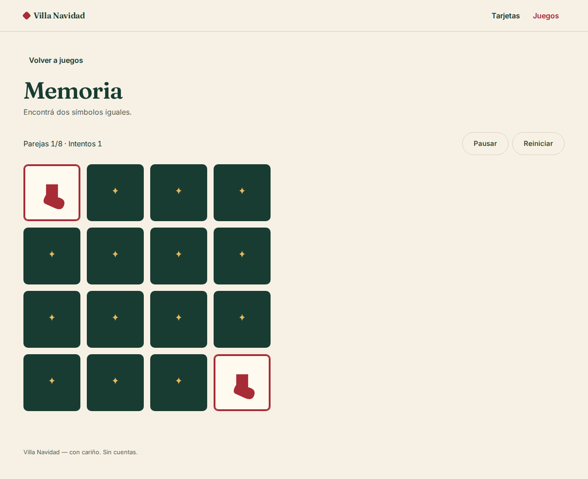
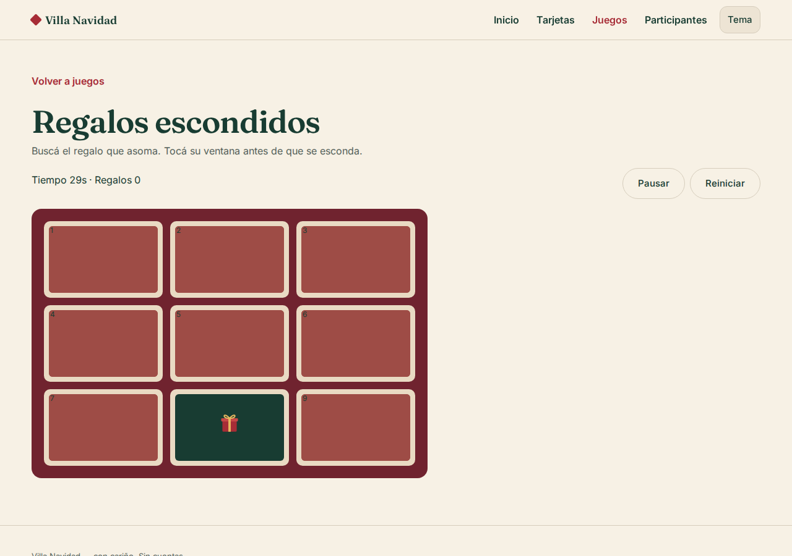
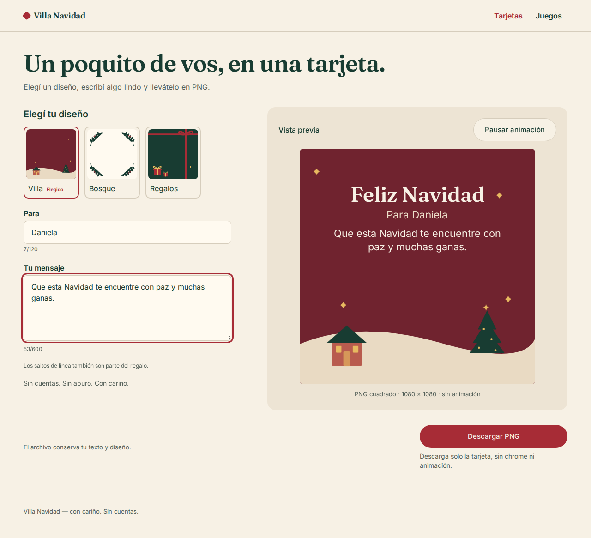

# Paridad React → vanilla + página Participantes

Referencia React (primer padre del merge vanilla `71eab17`):

**`2ad0b3493751b91c9fd6e464da2d98a429085814`**

## Regla vigente (owner / PO)

1. Las 3 pantallas React (inicio, tarjetas, juegos) quedan en **paridad** de funciones y diseño.
2. Multimedia y rúbrica que romperían esa paridad viven en **`participantes.html`**.
3. Nav: solo se suma el enlace a Participantes. Footer: enlace externo.

## Tabla React ↔ vanilla

| Pantalla / estado | React | Vanilla |
| --- | --- | --- |
| Landing |  |  |
| Selector de juegos |  |  |
| Memoria mid-play |  |  |
| Memoria fin |  |  |
| Regalos mid-play |  |  |
| Regalos fin |  |  |
| Tarjetas + preview |  |  |
| PNG descargado |  |  |

## Mapa función React → equivalente vanilla

| React | Vanilla |
| --- | --- |
| `Landing.tsx` | `index.html` + countdown |
| `Tarjetas` / `CardEditor` / `CardPreview` | `tarjetas.html` + `js/form.js` + `js/card-preview.js` + html-to-image |
| `Juegos.tsx` | `juegos.html` `#view-catalog` |
| `MemoriaPage` / `MemoryGame` | `juegos.html#memoria` |
| `RegalosPage` / `HiddenGiftsGame` | `juegos.html#regalos` |
| *(rúbrica multimedia / créditos)* | `participantes.html` |

## Checklist → archivo:línea

### Rúbrica MUST

| Ítem | Ubicación |
| --- | --- |
| HTML/CSS/JS separados, 0 inline/CDN, Tailwind CLI | `index.html:10–11`, `css/styles.css`, `js/main.js`; `npm run verify` |
| Semántica header/nav/main/section/footer | las 4 páginas (`header` ≈`:14`, `nav` ≈`:15`, `main` ≈`:46`, `footer`) |
| ≥3 páginas interconectadas (relativos) | `index.html` / `tarjetas.html` / `juegos.html` / `participantes.html` nav `:22–25` |
| Responsive Flex/Grid + media queries + variables | `css/custom.css` `:root` variables; `@media` `:791+` |
| JS ≥3 (hamburguesa, validación, tema) | `js/main.js:46` menú; `js/form.js` validación; `js/main.js` theme-toggle |
| Consola limpia / 0 404 | `scripts/verify.mjs` |

### Contenido obligatorio (enunciado)

| Ítem | Archivo:línea |
| --- | --- |
| `title` + `h1` Participantes | `participantes.html:8`, `:48` |
| `h1`–`h6` | `participantes.html:48,59,65,83,91,115,122` |
| `p`, `br`, `hr` | `participantes.html:49,56,89` |
| Listas `ul` / `ol` | `participantes.html:60`, `:123` |
| Enlaces internos (nav) | las 4 páginas `:22–25` |
| Enlace externo (footer) | `index.html:204`, `tarjetas.html:139`, `juegos.html:184`, `participantes.html:135` |
| Imagen como vínculo | `participantes.html:85–86` |
| Video | `participantes.html:68–71` (`./media/villa-navidad.mp4`) |
| Audio | `participantes.html:74–77` + botón `:79` (`./media/campana.mp3`) |
| Botones | nav tema/menú + forms/juegos |
| Checkbox | `participantes.html:103` |
| Placeholder | `participantes.html:100` (también `tarjetas.html:81,94`) |
| `strong` / `em` / `small` | `participantes.html:51,53,54` |
| Formulario | `participantes.html:92` (+ `tarjetas.html:52`) |
| Pie de página | footers de las 4 páginas |
| Selectores tipo `h1`–`h6`,`p` | `css/custom.css:105–110` (+ reglas `p`) |
| Clase / ID / tamaño img / bordes / padding / márgenes / box | `css/custom.css` `.img-thumb:159`, `#box-demo:77`, `border-radius`/`padding`/`margin`, `box-sizing:71–74` |
| Media queries / transiciones / animaciones | `css/custom.css` `@media:791+`, `transition:102`, `@keyframes:629+` |
| Menú hamburguesa | `js/main.js:46–77` + `#menu-toggle` en las 4 páginas |
| Créditos Daniel / Oscar | `participantes.html:51–53`, `:61–62` |
